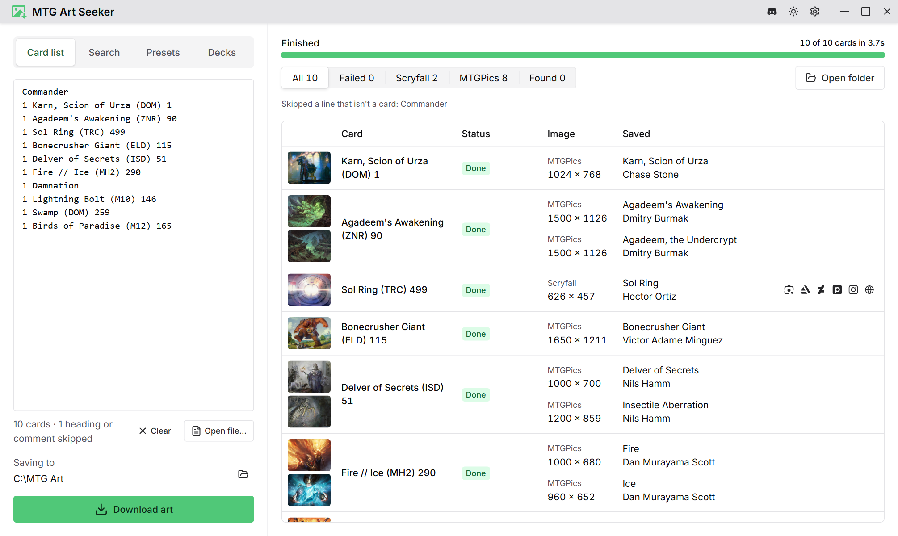
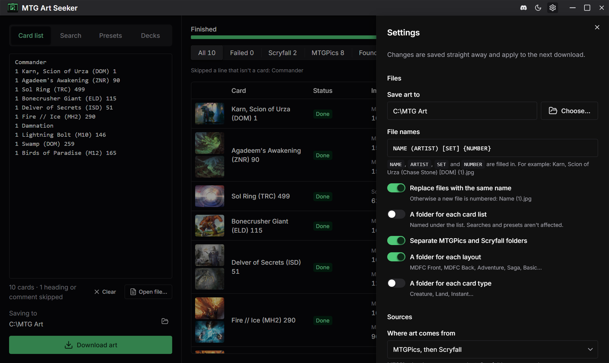

# MTG Art Downloader

Download Magic: The Gathering card art in bulk. Paste a deck list, run a Scryfall search, or pick an
EDHREC top list, and the app saves each card's art — from [MTGPics](https://www.mtgpics.com) where
it has it, since its art is larger and uncropped, and from [Scryfall](https://scryfall.com)
otherwise.

A desktop app for Windows, macOS and Linux, and a command line tool, both built on one Rust core.
It's a rewrite of [MTG Art Downloader](https://github.com/MrTeferi/MTG-Art-Downloader) by Mr Teferi,
by way of [Alex Taxiera's fork](https://github.com/alex-taxiera/mtg-art-downloader).

<picture>
  <source media="(prefers-color-scheme: dark)" srcset="docs/screenshots/results-dark.png" />
  
</picture>

## Install

Download the installer for your system from the
[latest release](https://github.com/AModSoul/mtg-art-downloader-rust/releases/latest). The app
checks for new versions when it starts and offers to update itself.

## Using it

**Card list.** One card per line, in the forms deck sites export:

```
Damnation
4 Lightning Bolt
4x Karn, Scion of Urza (DOM) 1
1 Sol Ring (C21) 263 *F*
Damnation [TSR] (106)
```

A set in brackets takes its collector number bare, in parentheses or in braces: `[TSR] 106`,
`[TSR] (106)`, `[TSR] {106}`.

Counts, foil and etched markers (`*F*`, `*E*`), and Archidekt categories and tags are ignored.
Section headings (`Commander`, `Sideboard`, `Creatures (12)`) and comments (`#`, `//`) are skipped.
A line with a set and collector number gets that exact printing; a line with only a name gets its
newest printing, or its oldest, or every printing's art — see the settings. A misspelt name is
matched to the closest card.

**Search.** Anything [Scryfall's search](https://scryfall.com/docs/syntax) takes —
`set:mh2 t:creature pow>=3` — and every matching card is downloaded. **Count matches** shows how
many first.

**Presets.** EDHREC's lists of the most-played Commander cards.

Files are named from a template, `NAME (ARTIST) [SET] {NUMBER}` by default, and by default go in
`mtgpics/` and `scryfall/` folders (and `web/` for copies you find), with a folder for each layout:
`MDFC Front` and `MDFC Back`, `Adventure`, `Saga`, `Basic`. A double-faced card is saved as one
image per face, and so is a split card such as Fire // Ice when MTGPics has both halves' paintings;
otherwise it's Scryfall's image of the whole card. When a run ends, **Retry failed** runs the cards
that failed again, and **Copy failed** copies them as a list.

With **A folder for each list** on, a card list's art goes in a folder of its own inside the save
folder, named in the field under the list. Opening a list file fills that field in with the file's
name; leave it empty to save in the save folder itself.

**Find a larger copy.** Scryfall's art is small. Next to each image that came from Scryfall, six
buttons open a window of the app's own to look for a bigger one: Google Lens, searching for that
art; a search for the card's artist on ArtStation, DeviantArt or Pixiv, or on Instagram through
Google; and the artist's own website, when their MTGPics page links one (most don't). Find the
largest copy you can, open it, and choose **Save image**. The app checks it's the same art and
larger than Scryfall's, then saves it in place of Scryfall's file, in a `web/` folder, marked
**Found** in the results with a link to the page it came from. If it doesn't look like a larger copy
of the art (a card scan, a smaller copy, or another painting), the app asks before saving it. Every
later download of that art gets your copy.

Replaced an image by mistake? Right-click its card in the results to save its art again from another
place it's known to be: MTGPics (if an earlier download found it there), Scryfall, or any copy you
found, listed with its site and size. The app keeps only where each one is, and downloads it again
when you go back to it. Later downloads of the card use the one you chose last.

Some sites, Instagram among them, cover their images so they can't be saved. On those, open the post
and choose **Find the art on this page** from the window's menu: the app downloads the images the
page has and shows them in its main window, each with its size and whether it looks like the art,
and saves the one you choose. It reads the page only when you ask, and only its images. You can
sign in to a site in that window; **Sign out of sites** forgets it. Whatever you save or ask about, a note in the window's corner says what came of it: saved, too
small, a card scan, or not the art.

### Settings



| Setting                   | Default                        |                                                    |
| ------------------------- | ------------------------------ | -------------------------------------------------- |
| Save art to               | `Pictures/MTG Art`             |                                                    |
| File names                | `NAME (ARTIST) [SET] {NUMBER}` |                                                    |
| Where art comes from      | MTGPics, then Scryfall         | or MTGPics only, or Scryfall only                  |
| Scryfall image            | Art crop                       | or the full card scan, as a PNG                    |
| Search MTGPics' art too   | Off                            | the Find a larger copy buttons beside MTGPics' art |
| Printing                  | Newest                         | for lines with only a name                         |
| Every printing's art      | Off                            | for lines with only a name                         |
| One printing per artwork  | On                             | skip reprints that reuse an art                    |
| Skip full-art printings   | Off                            |                                                    |
| Include extras            | On                             | Un-cards, oversized and championship cards         |
| A folder for each list    | Off                            | named in a field under the card list               |
| Folders                   | Source and layout              | a folder per card type can be added                |
| Replace files of one name | On                             | otherwise the new file is numbered: `Name (1).jpg` |

The settings live in `settings.json` in the app's config folder
(`%APPDATA%\io.github.amodsoul.mtg-art-downloader` on Windows,
`~/Library/Application Support/io.github.amodsoul.mtg-art-downloader` on macOS,
`~/.config/io.github.amodsoul.mtg-art-downloader` on Linux), which the command line tool reads too.

### Command line

```sh
mtg-art cards.txt                       # a card list file
mtg-art --search "set:mh2 t:creature"   # a Scryfall search
mtg-art --preset edhrec-top-year        # a preset; --presets lists them
mtg-art cards.txt --out ./art           # somewhere other than the settings' folder
mtg-art cards.txt --folder "Atraxa"     # in an Atraxa folder inside it
```

Build it with `cargo build --release -p mtg-art-cli`; the binary is `target/release/mtg-art`.

## How it finds art

Cards are looked up in a local copy of Scryfall's card data: its
[`default_cards` bulk file](https://scryfall.com/docs/api/bulk-data), every printing in English,
about 80 MB. The app downloads it in the background when it starts and whenever Scryfall publishes
a new one, which is daily; the command line tool checks before a list or preset (`--no-update`
skips that). It's kept in the app's local data folder
(`%LOCALAPPDATA%\io.github.amodsoul.mtg-art-downloader\card-data` on Windows), shared by both.

Scryfall itself is asked only about what the copy can't answer: a search, a misspelt name, a card
newer than the copy, and every card until the first copy is in. Those requests keep to
[Scryfall's rate limits](https://scryfall.com/docs/api/rate-limits) — lines with a set are looked up
75 at a time — however many cards are in flight.

A name gets the printings Scryfall's `!"name"` search would, except that a card with only a back
face of that name — a creature whose prepared spell is Demonic Tutor — is passed over when there's
a card of the name itself. A name no card has is tried as a flavor name, which some deck sites
export instead: `Megatron` is the Secret Lair Blightsteel Colossus, and is saved under that name.

MTGPics has no API, so its pages are read. A card is looked for at the page its set code and
collector number give (`dom001`), which must name the card and credit its artist. When it doesn't —
MTGPics numbers some sets its own way — the set's checklist is read, once per run, to find the
card's page by number, or by name and artist. Promos are found in MTGPics' promo lists by name and
artist. Whatever MTGPics lacks, including a double-faced card's back when MTGPics only has its
front, comes from Scryfall.

Every printing whose art is saved is logged, with where on MTGPics each face's art was found, in
`history.sqlite` beside the card data. The next time that printing is asked for, its art is
downloaded from there without searching MTGPics again; only if the image is gone from that address
is MTGPics searched afresh. A face MTGPics had no art for is looked for again after 30 days, in case
it has been added.

An image you save in that window is checked against Scryfall's art crop: the crop has to be found
inside it, at any size, and it has to be at least 10% wider than the crop. A match that covers too
little of the image, where the picture stops at the match's edges as at a card's frame, is a card
scan. Where you saved it from is logged by artwork, so every printing of the art is saved from
there, before MTGPics is asked; if the image is gone from there, it's forgotten. The app opens the
page and listens for what you save; it doesn't search or click for you, and reads a page only when
you choose **Find the art on this page**, and then only its images. A website is the one the
artist's MTGPics page links, kept for a month. Pixiv's artist search needs an account, so its button
searches Pixiv for the artist's name instead.

## Development

You need [Rust](https://rustup.rs), [Node 24](https://nodejs.org), and
[Tauri's system dependencies](https://v2.tauri.app/start/prerequisites/).

The JavaScript side is a [pnpm](https://pnpm.io) workspace; `corepack enable` once gets the pnpm
version the repo pins.

```sh
pnpm install
pnpm tauri-dev         # the desktop app, reloading as you edit
pnpm site-dev          # the website, on port 3000
cargo test --workspace # the core's tests; none reach the network
```

| Path                        | What's in it                                                                                         |
| --------------------------- | ---------------------------------------------------------------------------------------------------- |
| `crates/core`               | Everything that finds and saves art: list parsing, Scryfall and its card data, MTGPics, the run loop |
| `crates/cli`                | The `mtg-art` command line tool                                                                      |
| `apps/desktop/src-tauri`    | The desktop app's Tauri commands, over the core                                                      |
| `apps/desktop/src`          | The desktop app's interface: React and Chakra UI, showing what the core reports                      |
| `apps/desktop/src/bindings` | TypeScript types generated from the core's Rust types                                                |
| `packages/ui`               | The Chakra UI components and theme the app and the website share                                     |
| `apps/site`                 | The website, with the download page                                                                  |

After changing a type the interface uses, regenerate its TypeScript with `pnpm bindings`. CI fails
if they're out of date.

### Front end

```sh
pnpm storybook  # every component and state: the shared library on 6008, the app on 6009, the site on 6010
pnpm test       # unit tests, and every story as a browser test
pnpm lint       # oxlint; pnpm format runs oxfmt
```

Run `pnpm --filter desktop exec playwright install chromium` once before `pnpm test`. Git hooks
lint and format staged files on commit.

### Website

`apps/site` is the website at [getmtg.art](https://getmtg.art). The Site workflow prerenders it to
static HTML and deploys it to Cloudflare Pages whenever it changes on `trunk`, and again whenever a
release is published. It has no versions of its own and never makes a release. Its download page
lists whatever files the latest release has, sorted by the rules in
`apps/site/src/downloads/artifacts.ts`; a file no rule knows is still offered, under "Other files".

The workflow needs two repository secrets: `CLOUDFLARE_API_TOKEN`, a token with the account's
**Cloudflare Pages: Edit** permission, and `CLOUDFLARE_ACCOUNT_ID`. It creates the `getmtg-art` Pages
project on its first run; the domain is attached to that project in Cloudflare's dashboard.

### Agent instructions

[`AGENTS.md`](AGENTS.md), `.agents/skills/` and `.agents/mcp.json` are the sources of truth for
coding agents. `pnpm install` copies them to where Claude Code, Cursor and VS Code look for them
(`CLAUDE.md`, `.claude/skills/`, `.mcp.json`, `.cursor/mcp.json`, `.vscode/mcp.json`); those copies
are gitignored. The MCP servers are Chakra UI's docs and each Storybook's, which VS Code starts when
the folder opens.

### Releasing

1. Bump the version in `apps/desktop/src-tauri/tauri.conf.json`, `Cargo.toml` and
   `apps/desktop/package.json`.
2. Push a tag: `git tag v0.2.0 && git push origin v0.2.0`.
3. The Release workflow builds the installers and attaches them to a draft release. Publish it, and
   installed apps offer the update.

To build one platform's installer without a tag — to try a release out — run the Release workflow
by hand from the Actions tab and pick the platform. It goes into the same draft release, named for
the version in `tauri.conf.json`.

Update bundles are signed. The workflow needs two repository secrets: `TAURI_SIGNING_PRIVATE_KEY`,
the private key whose public half is in `tauri.conf.json`, and `TAURI_SIGNING_PRIVATE_KEY_PASSWORD`
(empty if the key has none). Losing the private key means installed apps can't update to a build
signed with a new one, so keep a copy somewhere safe.

The app icon is a placeholder. To replace it, run `pnpm --filter desktop tauri icon path/to/icon.png` with a square
PNG or SVG of at least 1024 pixels.

## License

[GPL-3.0](LICENSE), as the original is.
